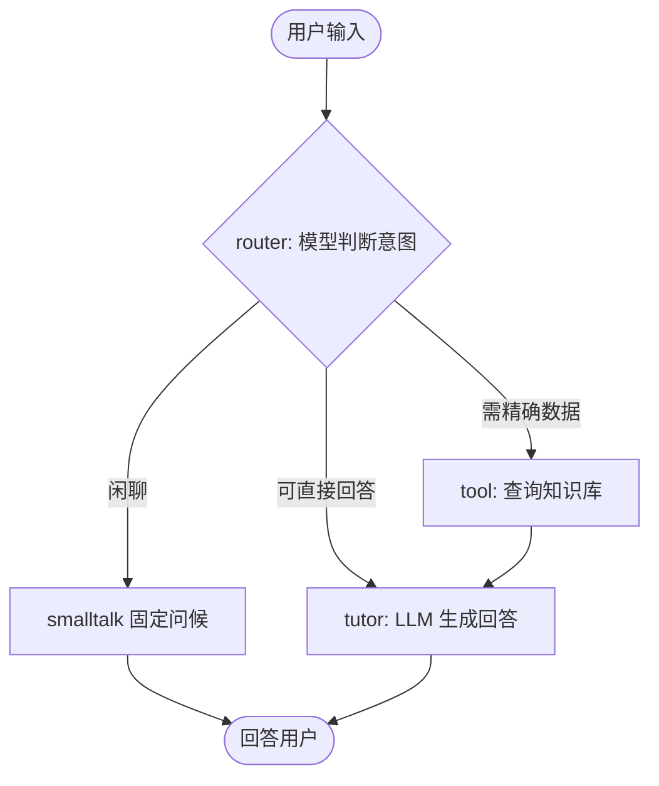

# Football Agent — 足球知识专家

一个基于 **LangGraph + DeepSeek** 的最小可运行 AI Agent：模型自主判断用户意图，动态选择回答路径；当问题需要精确数据时，自动调用工具查询本地知识库后作答。

## 项目架构



## 核心机制

- **条件边路由**：router 节点调用 LLM 将用户输入分类为 `smalltalk / answer / lookup`，LangGraph 条件边据此动态跳转——Agent 的"自主决定"发生在这里
- **工具调用**：`lookup` 路径先查本地知识库，将检索结果注入提示词（简化版 RAG），由 LLM 组织最终答案
- **抑制幻觉**：system 提示词强制"资料里没有就直说不知道"，避免模型编造事实

## 快速开始

```bash
python3 -m venv .venv && source .venv/bin/activate
pip install -r requirements.txt
export DEEPSEEK_API_KEY="你的key"   # https://platform.deepseek.com 申请
python agent.py
```

## 测试用例

| 输入 | 预期路径 | 验证点 |
|---|---|---|
| 你好 | router → smalltalk | 固定问候，不消耗生成 |
| 越位规则是什么 | router → tutor | LLM 直接回答 |
| 2022年世界杯冠军是谁 | router → tool → tutor | 回答含知识库内容（阿根廷/点球） |

## 技术栈

Python 3.10+ / LangGraph（State-Node-Edge-条件边） / DeepSeek API（OpenAI 兼容接口）
